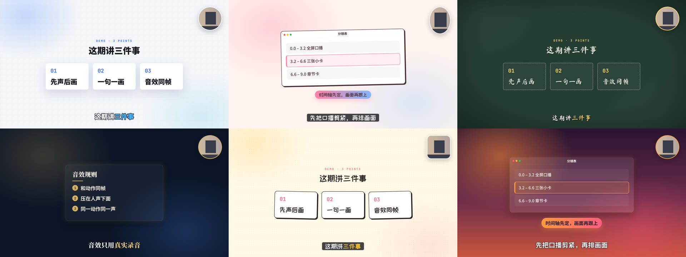
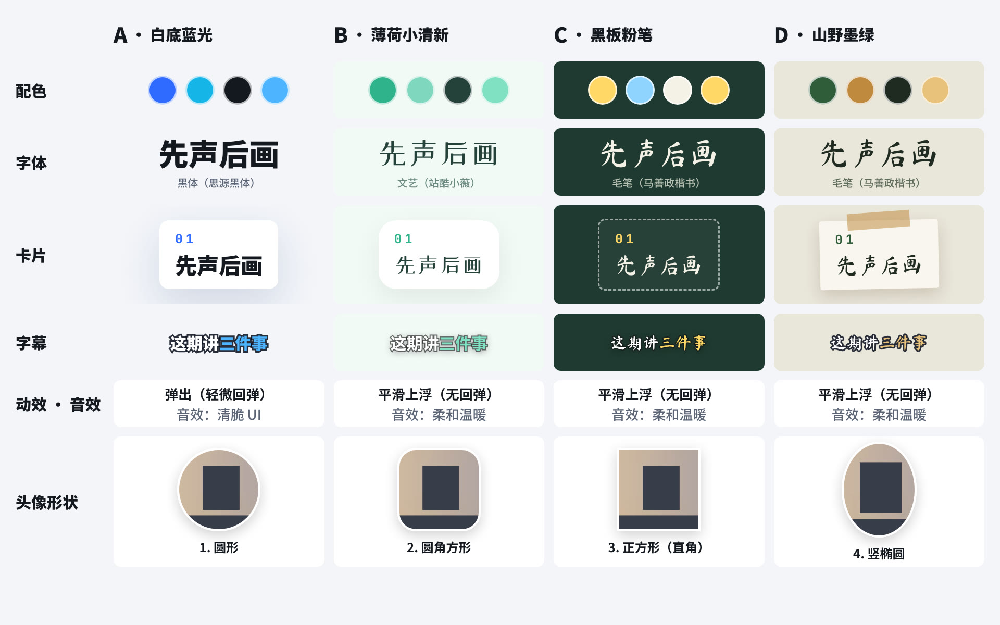

# talking-head-motion

给真人口播视频（横屏、竖屏都支持）加「图卡动效 + 小圆头像 + 烧录字幕 + 真实录音音效」的 AI skill，外加封面和各平台发布文案的规则。
适合讲 AI、产品、工具的知识类博主，配合 Claude Code 等能写代码的 AI 使用。



> 上图是同一段口播套用不同风格的样板（人像是占位剪影）。下图是「零件对照表」：几套风格拆开并排，配色、字体、卡片、字幕、动效音效、头像形状都可以单独挑。



> 竖屏三种版式：从左到右是全屏口播、上图下人、人全屏 + 浮卡、小头像 + 满屏图卡。


## 它解决什么问题

让 AI 剪口播，常见的结果是「在画面上贴几张图文」，节奏拖、音效有 AI 味，而且风格是 AI 定的，不一定是你喜欢的。
这个 skill 把一条口播从素材到发布拆成固定的流程，让 AI 产出零件、人来做导演：

1. **先选横屏还是竖屏、要做什么**：竖屏有三种版式可选（上图下人 / 人全屏 + 浮卡 / 小头像 + 满屏图卡），都避开了抖音底部的标题简介和右侧点赞列。
   要做的部分：图卡、章节卡、小头像、字幕、音效、配乐、封面、发布文案，每项附一句大白话说明，可以全选；勾了的才做，没勾的不花 token。
2. **按内容类型出风格样板**：AI 先听口播，判断是科技、生活、家庭、知识、商业还是美食旅行，再出这一类的 3 套风格。每套 4 张静帧 + 一段 4 秒带音效的小动图，外加一张「零件对照表」，先看再定。
3. **可以混搭**：配色、字体、卡片、头像形状（圆形 / 圆角方形 / 正方形 / 竖椭圆）、动效、音效包、字幕样式都能单独挑，比如「颜色要 A，字体要 B，头像要 C」。
4. **再做整片**：
   - **先声后画**：口播先剪紧（去掉气口和多余停顿），再按句子时间轴排画面。
   - **要不要加速你来定**：AI 先测你的语速（每秒多少字），对照日常聊天（约 4–5 字/秒）和节奏紧凑的口播博主（约 6.3–6.6 字/秒）给建议，你选了才加速。
   - **三种排版状态**：全屏口播 / 图卡 + 小头像 / 原位抠像 + 图卡，只在句子边界切换，交接 0.3 秒淡入淡出。
   - **节奏规则**：内容出全后最多再停 1 秒，句间不留空档。附自动检查脚本。
   - **音效跟着动作走**：只用真实录音，和动画同帧，同一动作永远同一个声音，压在人声下面。
   - **字幕**：烧进画面，关键词上色，英文词配中文；同时导出 .srt。
   - **打码**：只针对有法律风险的信息，小块马赛克。
   - **配乐**：按类型推荐可商用纯音乐给你试听，选好后只在图卡段落抬起来。
5. **发布包**：4:3 和 3:4 两种封面的版式规则（产品名必须是最大的字），抖音 / 小红书 / 视频号 / B 站的标题和简介、章节时间点。

**为什么要先选模块、先看样板？为了省 token，也省时间。**
直接让 AI 做整片，如果做完才发现不喜欢颜色或字体，整片的代码要重写一轮，渲染一次又要十几分钟。
静帧和几秒的小动图很便宜，几分钟就能出来，方向在这一步定下来，后面基本不用返工。
同样，没勾的模块（比如不要字幕、不要配乐）从头到尾都不做，也不花 token。

内置 6 类 × 3 套 = 18 套风格，换风格只改一个配置文件。

## 目录

```
skills/talking-head-motion/
├── SKILL.md              # 给 AI 读的主流程
├── references/           # 各环节的规则：风格挑选、风格卡、拍摄清单、分镜、节奏、字幕、音效、打码、配乐、封面、发布
└── template/             # Remotion 模板
    ├── src/config.js     # 全片设置：横屏 / 竖屏和竖屏版式、要做哪些模块、选哪套风格（可混搭）、头像位置（左上 / 右上）
    ├── src/styles.js     # 风格库：6 类 × 3 套，以及可以单独替换的零件
    ├── src/samples.js    # 风格样板里显示的内容（从这期口播里挑几句）
    ├── src/shots.js      # 分镜表（每期只改这里）
    ├── src/subs.js       # 字幕表
    ├── src/sfx.js        # 动作 → 音效，和动画共用一张节拍表
    └── tools/            # 出风格样板、测语速、节奏检查、导出 srt、抠像、打码、下载音效
```

## 安装

把 `skills/talking-head-motion` 复制到 Claude Code 的 skills 目录：

```bash
git clone https://github.com/jaydenxig/talking-head-motion.git
cp -r talking-head-motion/skills/talking-head-motion ~/.claude/skills/
```

然后对 AI 说：「用 talking-head-motion 帮我把这条口播做成短视频」，并给它口播视频和口播稿。

## 单独跑模板

需要 Node.js 18+ 和 ffmpeg。

```bash
cd skills/talking-head-motion/template
npm install
npm run sfx          # 下载真实录音音效到 public/sfx/
# 把你的口播放到 public/talk.mp4
node tools/make-samples.mjs --category life   # 出这一类的 3 套风格样板（静帧 + 小动图）
node tools/make-samples.mjs --styles tech-1 --portrait --layouts split,float,pip   # 竖屏：比较三种版式
# 在 src/config.js 里选定风格，改 src/shots.js 和 src/subs.js
npm run check        # 节奏检查
npm run still        # 出一张静帧看看
npm run render       # 渲染成片到 out/talk.mp4
npm run srt          # 导出字幕 .srt
```

## 现在的状态

v0.4：支持竖屏。规则来自作者实际做完的第一条视频、对两条参考视频的逐帧拆解，以及试用后加上的「先选模块、先看样板」流程。每做一期，会把新的修改沉淀进来。

## 许可

本仓库代码和文档使用 [MIT](LICENSE) 许可。用到的第三方工具和素材见 [THIRD_PARTY.md](THIRD_PARTY.md)，特别注意 Remotion 对公司用户有单独的授权要求。

---

**English summary.** An AI skill (for Claude Code and similar agents) that turns a landscape or portrait (9:16, with three layouts and platform safe zones) talking-head recording into a short video with motion-graphic cards, a small circular picture-in-picture, burned-in subtitles and real-recorded sound effects synced to animation events — plus rules for 4:3 / 3:4 covers and publishing copy for Chinese platforms. It first asks which modules you want, classifies the content (tech / life / family / knowledge / business / travel) and renders 3 style samples per category (stills + a 4-second clip with sound) so you can pick or mix palette, font, card, avatar shape, motion and sound pack before the full render. Includes a Remotion template with 18 styles, a pacing checker, SRT export, matting and targeted-mosaic helpers. Docs are in Chinese. MIT licensed; see THIRD_PARTY.md for Remotion, HyperFrames, Pixabay and RobustVideoMatting terms.
