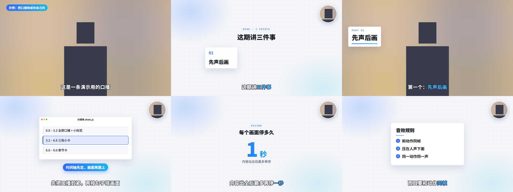

# talking-head-motion

给横屏真人口播视频加「图卡动效 + 小圆头像 + 烧录字幕 + 真实录音音效」的 AI skill，外加封面和各平台发布文案的规则。
适合讲 AI、产品、工具的知识类博主，配合 Claude Code 等能写代码的 AI 使用。



> 预览图里的人像是占位剪影，换成你自己的口播即可。

## 它解决什么问题

让 AI 剪口播，常见的结果是「在画面上贴几张图文」，节奏拖、音效有 AI 味。
这个 skill 把一条口播从素材到发布拆成固定的流程和规则，让 AI 产出零件、人来做导演：

- **先声后画**：口播先剪紧（去气口、1.1 倍速），再按句子时间轴排画面。
- **三种排版状态**：全屏口播 / 图卡 + 小圆头像 / 原位抠像 + 图卡，只在句子边界切换，交接 0.3 秒淡入淡出。
- **节奏规则**：内容出全后最多再停 1 秒，句间不留空档，空档用素材填。附自动检查脚本。
- **音效跟着动作走**：只用真实录音，和动画同帧触发，同一动作永远同一个声音，音量压在人声下面。
- **字幕**：底部白色粗字 + 深色描边，关键词上色，英文词配中文；烧进画面，同时导出 .srt。
- **打码**：只针对有法律风险的信息（别人公司名、邮箱、ID），小块马赛克。
- **发布包**：4:3 和 3:4 两种封面的版式规则（产品名必须是最大的字）、抖音 / 小红书 / 视频号 / B 站的标题和简介、章节时间点。

默认风格是「白底蓝光」：浅灰白底 + 细网格 + 白色 Mac 窗口 + 蓝色强调。换风格只改一个配置文件。

## 目录

```
skills/talking-head-motion/
├── SKILL.md              # 给 AI 读的主流程
├── references/           # 各环节的规则：风格卡、拍摄清单、分镜、节奏、字幕、音效、打码、配乐、封面、发布
└── template/             # Remotion 模板
    ├── src/config.js     # 全片设置：风格、头像位置（左上 / 右上）、字幕样式
    ├── src/shots.js      # 分镜表（每期只改这里）
    ├── src/subs.js       # 字幕表
    ├── src/sfx.js        # 动作 → 音效，和动画共用一张节拍表
    └── tools/            # 节奏检查、导出 srt、抠像、打码、下载音效
```

## 安装

把 `skills/talking-head-motion` 复制到 Claude Code 的 skills 目录：

```bash
git clone https://github.com/jaydenxig/talking-head-motion.git
cp -r talking-head-motion/skills/talking-head-motion ~/.claude/skills/
```

然后对 AI 说：「用 talking-head-motion 帮我把这条口播做成短视频」，并给它口播视频和口播稿。

## 单独跑模板

需要 Node.js 18+ 和 ffmpeg。

```bash
cd skills/talking-head-motion/template
npm install
npm run sfx          # 下载真实录音音效到 public/sfx/
# 把你的口播放到 public/talk.mp4，改 src/shots.js 和 src/subs.js
npm run check        # 节奏检查
npm run still        # 出一张静帧看看
npm run render       # 渲染成片到 out/talk.mp4
npm run srt          # 导出字幕 .srt
```

## 现在的状态

v0.1：规则来自作者实际做完的第一条视频，以及对两条参考视频的逐帧拆解。每做一期，会把新的修改沉淀进来。

## 许可

本仓库代码和文档使用 [MIT](LICENSE) 许可。用到的第三方工具和素材见 [THIRD_PARTY.md](THIRD_PARTY.md)，特别注意 Remotion 对公司用户有单独的授权要求。

---

**English summary.** An AI skill (for Claude Code and similar agents) that turns a landscape talking-head recording into a short video with motion-graphic cards, a small circular picture-in-picture, burned-in subtitles and real-recorded sound effects synced to animation events — plus rules for 4:3 / 3:4 covers and publishing copy for Chinese platforms. Includes a Remotion template (default style "light grid + blue glow"), a pacing checker, SRT export, matting and targeted-mosaic helpers. Docs are in Chinese. MIT licensed; see THIRD_PARTY.md for Remotion, HyperFrames, Pixabay and RobustVideoMatting terms.
